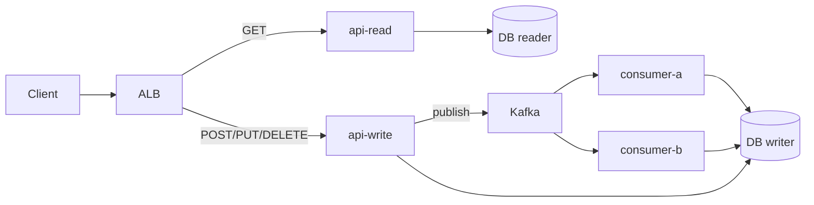

# Modular Monolith Deployments

#infrastructure

**One codebase, one image, many deployments.** The app is split into process roles (API, read API, write API, Kafka consumers, workers) and each role runs as its own ECS service / K8s Deployment. Same artifact everywhere; only `command`, env vars, replicas and resources differ.

The common setup at scale — sits between a classic monolith (one process does everything) and microservices (separate repos, images, databases).

Parent: [Deployment & Release Engineering](../deployment-and-release-engineering.md). Worked example: [node-modulith on ECS](../../case-studies/deploy-to-ecs-node-modulith.md).

---
## Naming

- **Modular monolith** — one codebase organised into modules with clear boundaries; deployed as several process roles. What this note describes.
- **Process types** — the [12-factor](https://12factor.net/processes) / Heroku name for the same idea (`web`, `worker`, `clock`).
- **Distributed monolith** — usually means the **anti-pattern**: microservices so coupled they must be deployed together. Avoid using it for this setup.

---
## Shape

| Deployment   | Command (same image)                | Ingress  | Scales on                 |
| ------------ | ----------------------------------- | -------- | ------------------------- |
| `api-read`   | `node dist/api/app.js` + `ROLE=read`  | ALB      | RPS / CPU                 |
| `api-write`  | `node dist/api/app.js` + `ROLE=write` | ALB      | RPS / CPU                 |
| `consumer-a` | `node dist/consumers/a/index.js`    | None     | Consumer lag              |
| `consumer-b` | `node dist/consumers/b/index.js`    | None     | Consumer lag              |
| `cron`       | `node dist/jobs/index.js`           | None     | Fixed (usually 1 replica) |

- **Read/write split** — read API points at [DB reader instances](../../../software-engineering/backend-software-engineering/assets/scaling-databases.md), write API at the writer. Routed by HTTP method or path at the ALB / Ingress ([traffic routing](traffic-routing-and-service-discovery.md)).
- **Consumers** — no public ingress; max useful replicas ≈ topic **partition count** ([Kafka — Partitions & Consumer Scaling](../../../../technologies/apache-kafka/apache-kafka.md#partitions--consumer-scaling)).

---
## Why split deployments

| Benefit                   | What it buys you                                                                             |
| ------------------------- | -------------------------------------------------------------------------------------------- |
| **Independent scaling**   | API scales on traffic, consumers on lag — no paying for API replicas to drain a backlog ([Autoscaling](autoscaling.md)) |
| **Fault isolation**       | A stuck or crash-looping consumer doesn't take down the API                                   |
| **Right-sized resources** | Per-role CPU/memory requests and limits                                                      |
| **Independent rollouts**  | Roll out / roll back one role at a time ([Deployment Strategies](deployment-strategies.md), [Rollbacks](rollbacks.md)) |
| **Clear observability**   | Dashboards and alarms per role instead of one blended process                                |

---
## Trade-offs

- **Shared release cadence** — one image means every role gets the new code; a change to consumer-a still ships to the API.
- **Shared dependencies** — one `package.json` / `pom.xml`; a dependency bump affects every role.
- **Schema migrations** — every role reads the same DB, so migrations must be backward-compatible with all running versions (expand/contract).
- **More moving parts** — N services, N task definitions / Deployments, N dashboards to maintain.
- **Module discipline** — boundaries are enforced by convention, not by the network; without care modules leak into each other.

---
## Monolith vs modular monolith vs microservices

|                     | **Monolith**          | **Modular monolith**                 | **Microservices**                 |
| ------------------- | --------------------- | ------------------------------------ | --------------------------------- |
| Repos               | 1                     | 1                                    | Many                              |
| Images              | 1                     | 1                                    | One per service                   |
| Deployments         | 1                     | One per role                         | One per service                   |
| Database            | Shared                | Shared (often writer + readers)      | One per service                   |
| Scale independently | No                    | Per role                             | Per service                       |
| Release             | All at once           | Same image, roll out per role        | Fully independent                 |
| Good fit            | Small app, small team | Most products at scale, one/few teams | Many teams, separate domains     |

---
## Practical notes

- **Same image tag everywhere** — CI builds once, tags with git SHA, updates every role to that tag ([Docker — one image, many services](../../../../technologies/docker/docker.md)).
- **Role via config, not code branches** — pick the entry point with `command`; keep `ROLE`-style env flags for small differences (e.g. which DB endpoint).
- **Graceful shutdown per role** — APIs drain connections; consumers commit offsets and leave the group cleanly.
- **Health checks differ** — HTTP probes for APIs; consumers need a liveness signal (heartbeat file, small health endpoint, or lag alarm).
