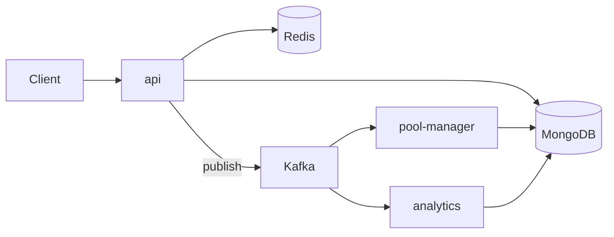

# Microservices

#infrastructure

**One service per business capability, each with its own image, deployment and (ideally) data.** Services talk over the network — HTTP/gRPC for requests, a message broker for events — and are built, released and scaled independently.

Parent: [Deployment Architectures](deployment-architectures.md). Siblings: [Monolith](monolith.md) · [Modular Monolith](modular-monolith.md).

**Repo:** https://github.com/vasil-sarandev/compactly — not deployed, runs locally with `docker compose`.

---
## Shape

compactly (URL shortener):

| Service        | Responsibility                                                                 |
| -------------- | ------------------------------------------------------------------------------ |
| `api`          | Serves redirects, creates short URLs by taking pre-generated slugs from a pool |
| `pool-manager` | Consumes Kafka events from `api` and refills the slug pool                     |
| `analytics`    | Consumes Kafka events from `api` and updates analytics                         |

- **Monorepo, separate images** — one [Turborepo](../../../technologies/turborepo/turborepo.md) repo, but each app has its own `Dockerfile` and image. Shared code lives in `packages/shared` and `packages/tooling`.
- **Async between services** — `api` publishes events to Kafka; `pool-manager` and `analytics` consume them.
- **Shared infra locally** — compose runs one MongoDB, Redis and Kafka for all services.

**vs modular monolith:** a [modular monolith](modular-monolith.md) runs the *same image* in different roles. Microservices have *different codebases/images* per service — each can change dependencies, language, or release cadence on its own.

---
## Core concerns

| Concern                   | What it means                                                                                     | Notes                                                                                                   |
| ------------------------- | ------------------------------------------------------------------------------------------------- | ------------------------------------------------------------------------------------------------------- |
| **Service boundaries**    | Split by business capability / bounded context, not by technical layer                           | Wrong boundaries → chatty services that must deploy together (the "distributed monolith" anti-pattern) |
| **Data ownership**        | Each service owns its data; others go through its API or events                                   | Shared DB tables recouple services                                                                      |
| **Communication**         | Sync (HTTP/gRPC) vs async (events)                                                                | [System Design — Communication](../../software-engineering/system-design/system-design.md#communication), [Messaging](../../software-engineering/system-design/system-design.md#messaging) |
| **Distributed transactions** | No cross-service ACID — use sagas, outbox, idempotent consumers                               | [System Design — Distributed Transactions](../../software-engineering/system-design/system-design.md#distributed-transactions), [Idempotent Operations](../../software-engineering/system-design/system-design.md#idempotent-operations) |
| **Service discovery**     | Services find each other by name, not IP                                                          | [Traffic Routing & Service Discovery](../deployment-and-release-engineering/assets/traffic-routing-and-service-discovery.md), [Service Discovery and Service Mesh](../../software-engineering/system-design/system-design.md#service-discovery-and-service-mesh) |
| **Edge**                  | One entry point routing to services, auth, rate limiting                                          | [API Gateway](../../software-engineering/system-design/system-design.md#api-gateway)                     |
| **Observability**         | A request spans many services                                                                     | Correlation IDs + distributed tracing; [Monitoring](../../software-engineering/system-design/system-design.md#monitoring) |

---
## Deploy & scale

- **One pipeline per service** — build and deploy only what changed (Turborepo / path filters in CI decide which services are affected).
- **Independent versions** — services run different versions side by side, so API and event contracts must stay backward-compatible.
- **Per-service scaling** — HTTP services on RPS/CPU, consumers on lag (≤ partition count) ([Autoscaling](../deployment-and-release-engineering/assets/autoscaling.md)).
- **Target** — usually [ECS](../deployment-targets/ecs.md) or [EKS](../deployment-targets/eks.md), one service / Deployment per microservice.
- **Shared infra in production** — broker, cache and databases move to managed services (MSK, ElastiCache, Atlas/DocumentDB).

---
## Why microservices

- **Team autonomy** — teams own, release and operate their services without coordinating deploys.
- **Independent tech choices** — each service picks its own dependencies, runtime, and datastore.
- **Fault and scale isolation** — at the service level, including data.

---
## Trade-offs

- **Distributed system costs** — network failures, retries, timeouts, eventual consistency.
- **Operational overhead** — N pipelines, N deployments, N dashboards, plus gateway, discovery and tracing.
- **Harder changes across services** — a feature touching three services means three coordinated, backward-compatible releases.
- **Testing** — integration needs contract tests or a full environment; local setup needs compose with every dependency.

---
## When to choose it

When **team or domain boundaries** — not just scaling — require independent codebases and releases. If the goal is only independent scaling or fault isolation, a [modular monolith](modular-monolith.md) gets most of it with far less overhead.
