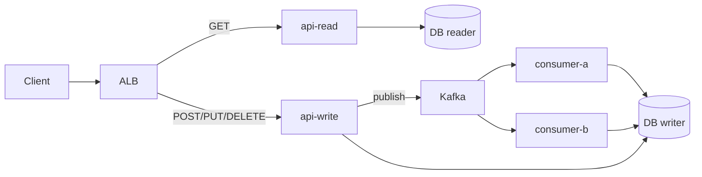

# Modular Monolith Deployments

#infrastructure

**One codebase, one image, many deployments.** The app is split into process roles (API, read API, write API, Kafka consumers, workers) and each role runs as its own ECS service / K8s Deployment. Same artifact everywhere; only `command`, env vars, replicas and resources differ.

The common setup at scale — sits between a classic [monolith](monolith.md) (one process does everything) and [microservices](microservices.md) (separate deployables per service, own databases). Comparison: [Deployment Architectures](deployment-architectures.md).

Parent: [Deployment Architectures](deployment-architectures.md). Siblings: [Monolith](monolith.md) · [Microservices](microservices.md). Worked example: [node-modulith on ECS](../case-studies/deploy-to-ecs-node-modulith.md) · repo: https://github.com/vasil-sarandev/node-modulith

---
## Naming

- **Modular monolith** — one codebase organised into modules with clear boundaries; deployed as several process roles. What this note describes.
- **Process types** — the [12-factor](https://12factor.net/processes) / Heroku name for the same idea (`web`, `worker`, `clock`).
- **Distributed monolith** — usually means the **anti-pattern**: microservices so coupled they must be deployed together. Avoid using it for this setup.

---
## Shape



| Deployment   | Command (same image)                | Ingress  | Scales on                 |
| ------------ | ----------------------------------- | -------- | ------------------------- |
| `api-read`   | `node dist/api/app.js` + `ROLE=read`  | ALB      | RPS / CPU                 |
| `api-write`  | `node dist/api/app.js` + `ROLE=write` | ALB      | RPS / CPU                 |
| `consumer-a` | `node dist/consumers/a/index.js`    | None     | Consumer lag              |
| `consumer-b` | `node dist/consumers/b/index.js`    | None     | Consumer lag              |
| `cron`       | `node dist/jobs/index.js`           | None     | Fixed (usually 1 replica) |

- **Read/write split** — read API points at [DB reader instances](../../software-engineering/backend-software-engineering/assets/scaling-databases.md), write API at the writer. Routed by HTTP method or path at the ALB / Ingress ([traffic routing](../deployment-and-release-engineering/assets/traffic-routing-and-service-discovery.md)).
- **Consumers** — no public ingress; max useful replicas ≈ topic **partition count** ([Kafka — Partitions & Consumer Scaling](../../../technologies/apache-kafka/apache-kafka.md#partitions--consumer-scaling)).

---
## One image, many commands

**One Dockerfile** at the repo root. Its default `CMD` starts the API; every other role overrides the command in its deployment config. Nothing role-specific lives in the image.

```dockerfile
FROM node:22-alpine AS base
WORKDIR /usr/src/app

FROM base AS development                    # local: tsx watch, source bind-mounted
COPY package.json package-lock.json ./
RUN npm ci
COPY . .
CMD ["npx", "tsx", "watch", "src/api/app.ts"]

FROM base AS build                          # compile TS → dist/
COPY package.json package-lock.json ./
RUN npm ci
COPY . .
RUN npm run compile

FROM base AS runtime                        # production image pushed to ECR
COPY --from=build /usr/src/app/dist ./dist  # (+ prod-only node_modules)
ENV NODE_ENV=production
CMD ["node", "dist/api/app.js"]             # default = API; override per role
```

**Local — `docker-compose.yaml`:** every service builds the same `development` target; consumers override `command`.

```yaml
services:
  api:
    build: { context: ., target: development }   # uses the default CMD
  user-marketing-consumer:
    build: { context: ., target: development }
    command: npx tsx watch src/consumers/user-marketing-consumer/index.ts
```

**Production — ECS task definition / K8s Deployment:** same image URI, different `command`.

```jsonc
// ECS task definition — user-marketing consumer
"containerDefinitions": [{
  "image": "<ecr>/node-modulith:<git-sha>",
  "command": ["node", "dist/consumers/user-marketing-consumer/index.js"]
}]
```

```yaml
# K8s Deployment — same idea
containers:
  - image: <ecr>/node-modulith:<git-sha>
    command: ["node", "dist/consumers/user-marketing-consumer/index.js"]
```

- **CI only swaps the image tag** — the command lives in each role's task definition / Deployment; the pipeline renders the new image into it and redeploys, per role.
- **Adding a role** = new entry point in `src/` + one more compose service + one more task definition / Deployment. No new Dockerfile.
- **vs a monorepo of services** (e.g. Turborepo) — usually one Dockerfile per app, each with its own build targets, so N Dockerfiles and N images. More flexible, more to maintain.

---
## Why split deployments

| Benefit                   | What it buys you                                                                             |
| ------------------------- | -------------------------------------------------------------------------------------------- |
| **Independent scaling**   | API scales on traffic, consumers on lag — no paying for API replicas to drain a backlog ([Autoscaling](../deployment-and-release-engineering/assets/autoscaling.md)) |
| **Fault isolation**       | A stuck or crash-looping consumer doesn't take down the API                                   |
| **Right-sized resources** | Per-role CPU/memory requests and limits                                                      |
| **Independent rollouts**  | Roll out / roll back one role at a time ([Deployment Strategies](../deployment-and-release-engineering/assets/deployment-strategies.md), [Rollbacks](../deployment-and-release-engineering/assets/rollbacks.md)) |
| **Clear observability**   | Dashboards and alarms per role instead of one blended process                                |

---
## Trade-offs

- **Shared release cadence** — one image means every role gets the new code; a change to consumer-a still ships to the API.
- **Shared dependencies** — one `package.json` / `pom.xml`; a dependency bump affects every role.
- **Schema migrations** — every role reads the same DB, so migrations must be backward-compatible with all running versions (expand/contract).
- **More moving parts** — N services, N task definitions / Deployments, N dashboards to maintain.
- **Module discipline** — boundaries are enforced by convention, not by the network; without care modules leak into each other.

---
## Practical notes

- **Same image tag everywhere** — CI builds once, tags with git SHA, updates every role to that tag ([Docker — one image, many services](../../../technologies/docker/docker.md)).
- **Role via config, not code branches** — pick the entry point with `command`; keep `ROLE`-style env flags for small differences (e.g. which DB endpoint).
- **Graceful shutdown per role** — APIs drain connections; consumers commit offsets and leave the group cleanly.
- **Health checks differ** — HTTP probes for APIs; consumers need a liveness signal (heartbeat file, small health endpoint, or lag alarm).
