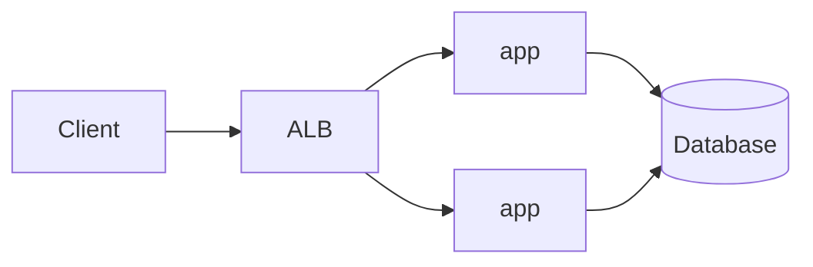

# Monolith

#infrastructure

**One codebase, one image, one process type.** Every request, background task and integration runs in the same process. To scale, run more copies of the whole app.

Parent: [Deployment Architectures](deployment-architectures.md). Siblings: [Modular Monolith](modular-monolith.md) · [Microservices](microservices.md).

**Repo:** https://github.com/vasil-sarandev/showtimex — case study: [Deploy showtimex to EC2 with Docker](../case-studies/deploy-to-ec2-docker-showtimex.md)

---
## Shape

- **Internally structured, externally one unit** — showtimex uses a service-oriented architecture inside the app, but ships as one `showtimex-api` container.
- **One deployable** — CI builds one image; every deploy replaces every copy of it.
- **Shared database** — one schema, transactions across domains are plain DB transactions.

---
## Deploy & scale

| Concern           | Monolith                                                                                       |
| ----------------- | ---------------------------------------------------------------------------------------------- |
| **Target**        | Single VM, ASG behind ALB, or one ECS service ([Deployment targets](../deployment-targets/deployment-targets.md)) |
| **Scale out**     | More identical copies behind the load balancer ([Autoscaling](../deployment-and-release-engineering/assets/autoscaling.md)) |
| **Scale up**      | Bigger instance — often the first and cheapest move                                             |
| **Database**      | Usually the first bottleneck — read replicas, connection pooling ([Scaling Databases](../../software-engineering/backend-software-engineering/assets/scaling-databases.md)) |
| **Rollout**       | Rolling / blue-green of the whole app ([Deployment Strategies](../deployment-and-release-engineering/assets/deployment-strategies.md)) |
| **Background work** | In-process (timers, in-memory queues) — competes with request handling for CPU/memory         |

showtimex in production: one EC2 instance running one container, ALB in front, RDS Postgres in a private subnet, deployed via GitHub Actions → ECR → SSM Run Command.

---
## Why a monolith

- **Simplest to build, run and debug** — one process, one log stream, one stack trace.
- **No network between modules** — function calls instead of HTTP/Kafka; no partial failures or retries between parts.
- **Real transactions** — ACID across the whole domain without sagas.
- **One pipeline** — one build, one image, one deploy.

---
## Trade-offs

- **All-or-nothing scaling** — a CPU-heavy job forces scaling the whole app, including the parts that are idle.
- **No fault isolation** — a memory leak or blocking task in one area takes down everything.
- **Every deploy ships everything** — a small change redeploys the whole app; risk grows with size.
- **Coupling creeps in** — without discipline, modules reach into each other's tables and internals.

---
## When to move on

Split into a [modular monolith](modular-monolith.md) when parts of the app need **different scaling or isolation** — e.g. Kafka consumers or background jobs that shouldn't share CPU with the API. Keep the single codebase; split process roles first, services later (if ever).
